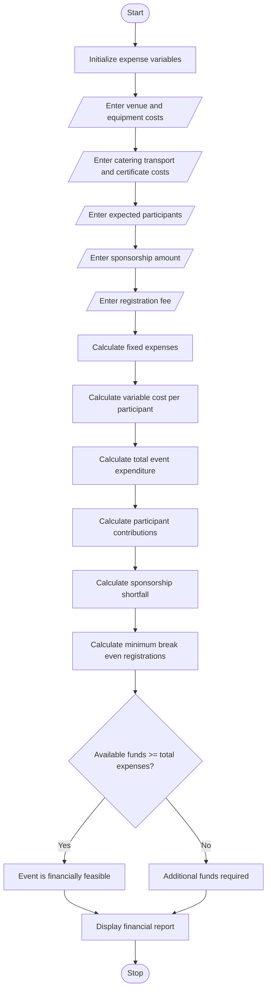

# Campus Event Financial Planning – Python Program

## 1. Problem Statement

Develop a Python program to calculate the financial requirements of a campus event by considering venue, equipment, catering, transport, and certificate costs. The program should calculate the total event expenditure, participant contributions, sponsorship amount, sponsorship shortfall, and minimum number of registrations required to break even.

## 2. Algorithm

1. Start the program.
2. Initialize event expense variables.
3. Enter venue cost.
4. Enter equipment cost.
5. Enter catering cost per participant.
6. Enter transport cost per participant.
7. Enter certificate cost per participant.
8. Enter expected number of participants.
9. Enter sponsorship amount.
10. Enter registration fee per participant.
11. Calculate fixed expenses.
12. Calculate variable expenses per participant.
13. Calculate total event expenditure.
14. Calculate total participant contributions.
15. Calculate sponsorship shortfall.
16. Calculate total available funds.
17. Calculate the minimum registration count required to break even.
18. Compare available funds with total expenses.
19. Display the complete event financial report.
20. Stop.

## 3. Flowchart (Mermaid Code)


## 5. Sample Input

```
Enter venue cost: 10000
Enter equipment cost: 5000
Enter catering cost per participant: 200
Enter transport cost per participant: 100
Enter certificate cost per participant: 50
Enter expected number of participants: 100
Enter sponsorship amount: 10000
Enter registration fee per participant: 300
```

## 6. Sample Output

```
========== CAMPUS EVENT FINANCIAL REPORT ==========

Venue Cost: Rs. 10000.0
Equipment Cost: Rs. 5000.0
Catering Cost Per Participant: Rs. 200.0
Transport Cost Per Participant: Rs. 100.0
Certificate Cost Per Participant: Rs. 50.0

Fixed Expenses: Rs. 15000.0
Variable Cost Per Participant: Rs. 350.0
Total Variable Expenses: Rs. 35000.0
Total Event Expenses: Rs. 50000.0

Expected Participants: 100
Registration Fee Per Participant: Rs. 300.0
Participant Contributions: Rs. 30000.0
Sponsorship Amount: Rs. 10000.0
Total Available Funds: Rs. 40000.0
Sponsorship Shortfall: Rs. 10000.0

Minimum Registrations Required: 300

Event Status: Additional Funds Required
Deficit Amount: Rs. 10000.0

========== END OF REPORT ==========
```

