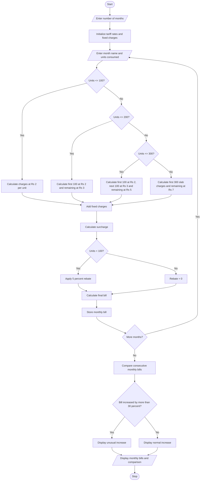

# Progressive Electricity Billing System Using Python

## 1. Problem Statement

Design and develop a Python program for a Progressive Electricity Billing System. The system calculates household electricity bills based on monthly electricity consumption using multiple tariff slabs. It applies fixed charges, additional surcharges, and rebates according to predefined conditions. The program collects electricity consumption details for several months, calculates the total bill for each month, compares monthly bills, and identifies unusual increases in electricity bills. Finally, it displays the monthly billing details and highlights months with significant increases in electricity charges.

## 2. Algorithm

1. Start the program.
2. Read the number of months.
3. Set electricity tariff rates for different consumption slabs.
4. Set fixed charges, surcharge percentage, and rebate percentage.
5. For each month:
   - Enter month name.
   - Enter electricity units consumed.
6. Calculate energy charges using progressive slabs:
   - First 100 units: ₹2 per unit.
   - Next 100 units: ₹3 per unit.
   - Next 100 units: ₹5 per unit.
   - Above 300 units: ₹7 per unit.
7. Add fixed charges of ₹50.
8. Calculate surcharge of 5% on energy charges.
9. If consumption is below 100 units, apply a 5% rebate on energy charges.
10. Calculate the final electricity bill.
11. Store the monthly bill details.
12. Compare each month's bill with the previous month's bill.
13. Identify unusual increases when the bill increases by more than 30%.
14. Display monthly consumption, energy charges, surcharge, rebate, and final bill.
15. Display unusual increases.
16. Stop the program.

## 3. Flowchart (Mermaid Code)



## 5. Sample Input

```
Enter number of months: 4

Enter details for Month 1
Enter month name: January
Enter electricity units consumed: 80

Enter details for Month 2
Enter month name: February
Enter electricity units consumed: 120

Enter details for Month 3
Enter month name: March
Enter electricity units consumed: 180

Enter details for Month 4
Enter month name: April
Enter electricity units consumed: 300
```

## 6. Sample Output

```
Energy Charge: Rs. 160.0
Fixed Charge: Rs. 50
Surcharge: Rs. 8.0
Rebate: Rs. 8.0
Total Bill: Rs. 210.0

Energy Charge: Rs. 260.0
Fixed Charge: Rs. 50
Surcharge: Rs. 13.0
Rebate: Rs. 0
Total Bill: Rs. 323.0

Energy Charge: Rs. 440.0
Fixed Charge: Rs. 50
Surcharge: Rs. 22.0
Rebate: Rs. 0
Total Bill: Rs. 512.0

Energy Charge: Rs. 1000.0
Fixed Charge: Rs. 50
Surcharge: Rs. 50.0
Rebate: Rs. 0
Total Bill: Rs. 1100.0

========== MONTHLY BILL COMPARISON ==========

January Bill: Rs. 210.0
February Bill: Rs. 323.0
March Bill: Rs. 512.0
April Bill: Rs. 1100.0

========== UNUSUAL BILL INCREASES ==========

February - Unusual increase detected
Increase: Rs. 113.0
Increase Percentage: 53.81 %

March - Unusual increase detected
Increase: Rs. 189.0
Increase Percentage: 58.51 %

April - Unusual increase detected
Increase: Rs. 588.0
Increase Percentage: 114.84 %
```

