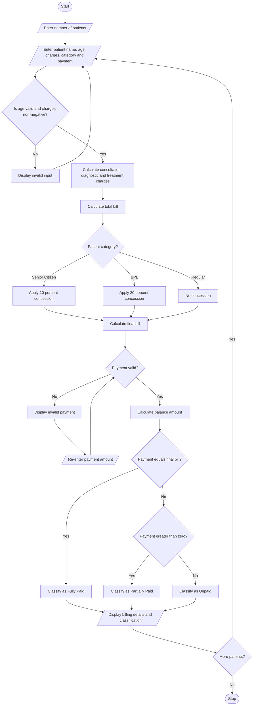

# Hospital Billing and Patient Classification System Using Python

## 1. Problem Statement

Design and develop a Python program for a Hospital Billing and Patient Classification System. The system calculates the total hospital bill based on consultation charges, diagnostic charges, and treatment charges. It applies conditional concessions depending on patient category and validates billing constraints such as age, charges, and payment amount. Based on the total bill and payment details, the system classifies patients into different payment categories according to a predefined payment policy. Finally, the program displays the billing details, concessions, final bill amount, balance amount, and patient classification.

## 2. Algorithm

1. Start the program.
2. Enter the number of patients.
3. For each patient, enter:
   - Patient name
   - Patient age
   - Consultation charges
   - Diagnostic charges
   - Treatment charges
   - Patient category (Senior Citizen, Regular, or Below Poverty Line).
   - Amount paid.
4. Validate patient age and billing charges.
5. Calculate the total bill by adding consultation, diagnostic, and treatment charges.
6. Apply concessions:
   - Senior citizens receive a 10% concession.
   - Below Poverty Line patients receive a 20% concession.
   - Regular patients receive no concession.
7. Calculate the final bill after concession.
8. Validate the payment amount.
9. Calculate the balance amount.
10. Classify the patient:
    - Fully Paid: Payment equals the final bill.
    - Partially Paid: Payment is greater than zero but less than the final bill.
    - Unpaid: Payment is zero.
11. Display the complete billing details.
12. Repeat for all patients.
13. Stop the program.

## 3. Flowchart (Mermaid Code)


## 5. Sample Input

```
Enter number of patients: 3

Enter details of Patient 1
Enter patient name: Ravi
Enter patient age: 65
Enter consultation charges: 500
Enter diagnostic charges: 1000
Enter treatment charges: 3000
Enter patient category (1-3): 1
Enter amount paid: 4000

Enter details of Patient 2
Enter patient name: Priya
Enter patient age: 30
Enter consultation charges: 500
Enter diagnostic charges: 1500
Enter treatment charges: 4000
Enter patient category (1-3): 3
Enter amount paid: 2000

Enter details of Patient 3
Enter patient name: Kumar
Enter patient age: 40
Enter consultation charges: 300
Enter diagnostic charges: 700
Enter treatment charges: 2000
Enter patient category (1-3): 2
Enter amount paid: 0
```

## 6. Sample Output

```
========== HOSPITAL BILLING REPORT ==========

Patient Name: Ravi
Age: 65
Category: Senior Citizen
Total Bill: Rs. 4500.0
Concession: Rs. 450.0
Final Bill: Rs. 4050.0
Amount Paid: Rs. 4000.0
Balance Amount: Rs. 50.0
Payment Classification: Partially Paid

Patient Name: Priya
Age: 30
Category: Regular
Total Bill: Rs. 6000.0
Concession: Rs. 0.0
Final Bill: Rs. 6000.0
Amount Paid: Rs. 2000.0
Balance Amount: Rs. 4000.0
Payment Classification: Partially Paid

Patient Name: Kumar
Age: 40
Category: Below Poverty Line
Total Bill: Rs. 3000.0
Concession: Rs. 600.0
Final Bill: Rs. 2400.0
Amount Paid: Rs. 0.0
Balance Amount: Rs. 2400.0
Payment Classification: Unpaid

Total Patients Processed: 3
```

