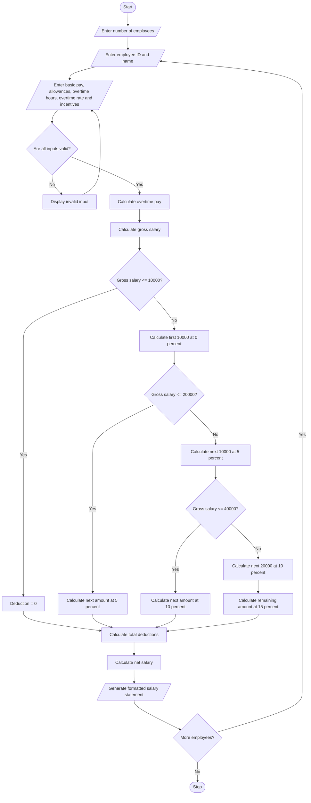

# Employee Payroll and Deduction Analysis Using Python

## 1. Problem Statement

Design and develop a Python program for an Employee Payroll and Deduction Analysis System. The system calculates the gross salary of employees based on basic pay, allowances, overtime hours, overtime rate, and incentives. It applies progressive deductions according to predefined salary slabs. The program calculates the total deductions and net salary for each employee. Finally, it generates a formatted salary statement displaying employee details, gross salary, deductions, and net salary.

## 2. Algorithm

1. Start the program.
2. Enter the number of employees.
3. For each employee, enter:
   - Employee ID
   - Employee name
   - Basic salary
   - House Rent Allowance (HRA)
   - Dearness Allowance (DA)
   - Overtime hours
   - Overtime rate per hour
   - Incentives
4. Validate the entered salary details.
5. Calculate overtime pay.
6. Calculate gross salary using basic pay, allowances, overtime pay, and incentives.
7. Calculate progressive deductions:
   - First ₹10,000: 0% deduction.
   - Next ₹10,000: 5% deduction.
   - Next ₹20,000: 10% deduction.
   - Above ₹40,000: 15% deduction.
8. Calculate total deductions.
9. Calculate net salary by subtracting deductions from gross salary.
10. Generate the formatted salary statement.
11. Display employee salary details.
12. Repeat for all employees.
13. Stop the program.

## 3. Flowchart (Mermaid Code)


## 5. Sample Input

```
Enter number of employees: 2

Enter Employee Details 1
Enter employee ID: E101
Enter employee name: Ravi
Enter basic pay: 25000
Enter HRA: 5000
Enter DA: 3000
Enter overtime hours: 10
Enter overtime rate per hour: 200
Enter incentives: 2000

Enter Employee Details 2
Enter employee ID: E102
Enter employee name: Priya
Enter basic pay: 15000
Enter HRA: 3000
Enter DA: 2000
Enter overtime hours: 5
Enter overtime rate per hour: 100
Enter incentives: 1000
```

## 6. Sample Output

```
========== EMPLOYEE SALARY STATEMENTS ==========

----------------------------------------
          SALARY STATEMENT
----------------------------------------
Employee ID       : E101
Employee Name     : Ravi
Basic Pay         : Rs. 25000.0
HRA               : Rs. 5000.0
DA                : Rs. 3000.0
Overtime Pay      : Rs. 2000.0
Incentives        : Rs. 2000.0
----------------------------------------
Gross Salary      : Rs. 37000.0
Total Deductions  : Rs. 2200.0
Net Salary        : Rs. 34800.0
----------------------------------------

----------------------------------------
          SALARY STATEMENT
----------------------------------------
Employee ID       : E102
Employee Name     : Priya
Basic Pay         : Rs. 15000.0
HRA               : Rs. 3000.0
DA                : Rs. 2000.0
Overtime Pay      : Rs. 500.0
Incentives        : Rs. 1000.0
----------------------------------------
Gross Salary      : Rs. 21500.0
Total Deductions  : Rs. 650.0
Net Salary        : Rs. 20850.0
----------------------------------------
```
