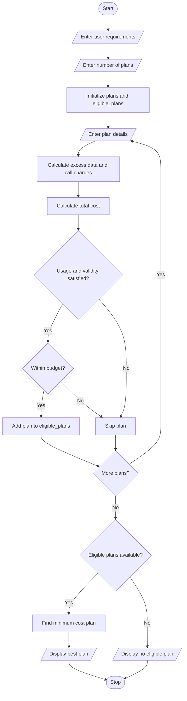

# Multi-Plan Telecommunications Cost Optimization – Python Program

### 1. Problem Statement

Develop a Python program to evaluate multiple mobile recharge plans based on required data, call minutes, validity, and budget. Calculate excess usage charges, identify eligible plans, and select the most economical plan that satisfies all user requirements.

### 2. Algorithm

1. Start the program.
2. Create empty lists for plans and eligible plans.
3. Enter required data, call minutes, validity, and budget.
4. Enter the number of mobile plans.
5. For each plan, input plan name, price, data limit, call minutes, validity, and excess charges.
6. Calculate additional data and call charges.
7. Calculate the total plan cost.
8. Check whether the plan satisfies usage, validity, and budget requirements.
9. Store eligible plans.
10. Find the most economical eligible plan.
11. Display all plan details and the best plan.
12. If no plan is eligible, display a suitable message.
13. Stop.

### 3. Flowchart (Mermaid Code)



### 5. Sample Input

```
Enter required data in GB: 2
Enter required call minutes: 500
Enter required validity in days: 28
Enter your budget: 300
Enter number of mobile plans: 3

Enter details of Plan 1
Enter plan name: Basic
Enter plan price: 199
Enter data limit in GB: 1.5
Enter call minutes: 400
Enter validity in days: 28
Enter extra data charge per GB: 20
Enter extra call charge per minute: 1

Enter details of Plan 2
Enter plan name: Smart
Enter plan price: 249
Enter data limit in GB: 2
Enter call minutes: 500
Enter validity in days: 28
Enter extra data charge per GB: 20
Enter extra call charge per minute: 1

Enter details of Plan 3
Enter plan name: Premium
Enter plan price: 299
Enter data limit in GB: 3
Enter call minutes: 600
Enter validity in days: 56
Enter extra data charge per GB: 20
Enter extra call charge per minute: 1
```

### 6. Sample Output

```
----- PLAN DETAILS -----

Plan Name: Basic
Base Price: 199.0
Extra Data: 0.5 GB
Extra Calls: 100.0 minutes
Total Cost: 309.0

Plan Name: Smart
Base Price: 249.0
Extra Data: 0.0 GB
Extra Calls: 0.0 minutes
Total Cost: 249.0

Plan Name: Premium
Base Price: 299.0
Extra Data: 0 GB
Extra Calls: 0 minutes
Total Cost: 299.0

----- RESULT -----

Most Economical Eligible Plan: Smart
Total Cost: Rs. 249.0
Data: 2.0 GB
Calls: 500.0 minutes
Validity: 28 days

Eligible Plans: 2
Total Plans Evaluated: 3
```

