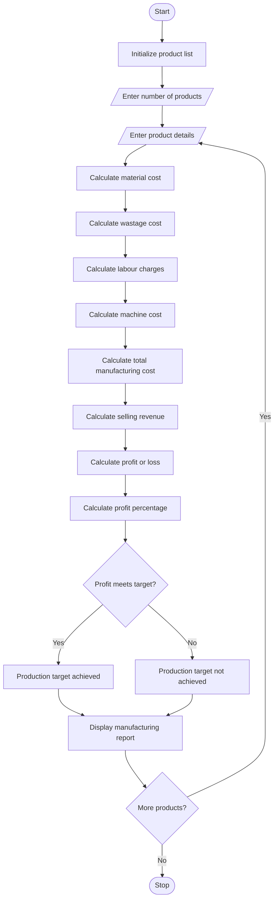

# Multi-Currency Travel Budget Analysis – Python Program

## 1. Problem Statement

Develop a Python program to analyze travel expenses in multiple currencies by converting expenses into a common base currency using supplied exchange rates. The program should include currency conversion fees, compare total spending against a specified travel budget, identify the largest expense category, and display the final travel budget report.

## 2. Algorithm

1. Start the program.
2. Initialize an empty expense list.
3. Enter the travel budget in the base currency.
4. Enter the base currency code.
5. Enter the number of expense categories.
6. For each category, enter category name and expense amount.
7. Enter the foreign currency code and exchange rate.
8. Enter the currency conversion fee percentage.
9. Convert the expense into the base currency.
10. Calculate the conversion fee.
11. Calculate the total expense including conversion fees.
12. Calculate total travel expenses.
13. Compare total expenses against the travel budget.
14. Identify the largest expense category.
15. Calculate the remaining budget or excess amount.
16. Display the complete travel budget report.
17. Stop.

## 3. Flowchart (Mermaid Code)



## 5. Sample Input

```
Enter your travel budget: 100000
Enter base currency (INR/USD/EUR): INR
Enter number of expense categories: 3

Enter details of Expense 1
Enter expense category: Hotel
Enter expense amount: 300
Enter currency code: USD
Enter exchange rate: 85
Enter conversion fee percentage: 2

Enter details of Expense 2
Enter expense category: Food
Enter expense amount: 150
Enter currency code: USD
Enter exchange rate: 85
Enter conversion fee percentage: 2

Enter details of Expense 3
Enter expense category: Transport
Enter expense amount: 200
Enter currency code: EUR
Enter exchange rate: 90
Enter conversion fee percentage: 3
```

## 6. Sample Output

```
========== TRAVEL BUDGET REPORT ==========

Expense Category: Hotel
Original Amount: 300 USD
Converted Amount: 25500.0 INR
Conversion Fee: 510.0 INR
Total Expense: 26010.0 INR

Expense Category: Food
Original Amount: 150 USD
Converted Amount: 12750.0 INR
Conversion Fee: 255.0 INR
Total Expense: 13005.0 INR

Expense Category: Transport
Original Amount: 200 EUR
Converted Amount: 18000.0 INR
Conversion Fee: 540.0 INR
Total Expense: 18540.0 INR

---------- FINAL SUMMARY ----------

Travel Budget: 100000 INR
Total Travel Expenses: 57555.0 INR
Remaining Budget: 42445.0 INR
Budget Status: Within Budget

Largest Expense Category: Hotel
Largest Expense Amount: 26010.0 INR

========== END OF REPORT ==========
```


Note: Exchange rates and conversion fee percentages are supplied by the user. The sample values are illustrative and are not live exchange rates.
